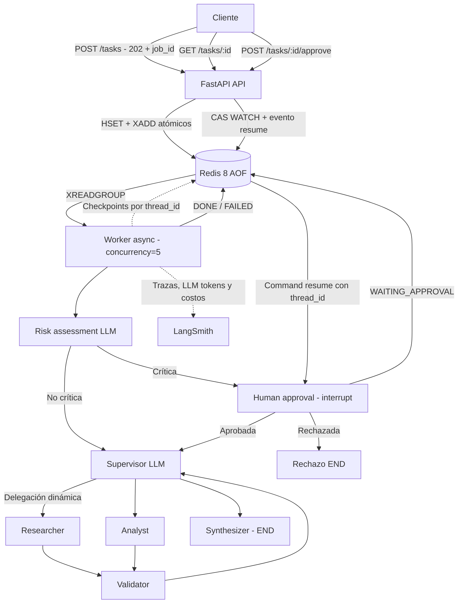

# Pre-entrega 7 · API de producción y monitoreo activo

**FastAPI asíncrona + orquestador jerárquico de Pre-entrega 6 + Redis Streams + AsyncRedisSaver + LangSmith + Human-in-the-loop.**

> Estado de entrega: código e infraestructura preparados; **las capturas del dashboard y las métricas reales requieren ejecutar el sistema con tus credenciales**. No se inventan costos ni p95. Los datos internos `Starter/Growth` son ficticios y se emplean únicamente para una prueba reproducible.

## Arquitectura



- **API** en `app/main.py`: `POST /tasks`, `GET /tasks/{id}`, `POST /tasks/{id}/approve`, `/health`. Un handler **no ejecuta** un LLM ni espera la finalización de la tarea.
- **Worker separado** en `app/worker.py`: consume Redis Streams (consumer group), atiende trabajos concurrentes con `asyncio` y registra fallos en Redis.
- **Estado** en `app/store.py`: hash por job, idempotencia en decisión humana (`WATCH` / transacción), cola `XADD` atómica junto a `HSET`.
- **Checkpoint real** en Redis 8 mediante `AsyncRedisSaver` en el worker. `thread_id = job_id` permite reanudar tras interrupción, incluso si se reinicia el worker.
- **HITL** en `app/hitl.py`: modelo clasifica riesgo; los pedidos críticos se pausan con `interrupt()` **antes** de los especialistas, y se reanudan mediante `Command(resume={...})` desde Redis.
- **Observabilidad** en `app/observability.py`: `@traceable`, seguimiento LangGraph/LangChain automático de subtrazas (modelo, herramientas, nodos), tags `job:<id>` y `batch:<id>`.
- **Agentes M6** en `orchestrator/`: supervisor, investigador, analista, validador, síntesis y fuentes de ejemplo; se reutiliza su implementación, no una respuesta simulada de orquestación.

## Requisitos

- Docker Desktop + Compose, o Python 3.12+ con `redis:8-alpine` corriendo.
- Una **OPENAI_API_KEY** con facturación habilitada para probar modelos reales.
- Una **LANGSMITH_API_KEY** para capturar trazas, costo de cada run y latencia p95.
- Una **APPROVAL_API_KEY** fuerte para autorizar el endpoint HITL.

**¿Por qué Redis 8?** La integración oficial de checkpoints requiere compatibilidad con JSON y RediSearch; un contenedor Redis 7 tradicional sin módulos no alcanza. La persistencia AOF mantiene datos tras reinicios normales del contenedor.

## 1. Levantar con Docker Compose (recomendado)

En PowerShell:

```powershell
Copy-Item .env.example .env
notepad .env
```

Ingresar allí tus valores reales:

```dotenv
OPENAI_API_KEY=tu_clave_real
LANGSMITH_API_KEY=tu_clave_real
APPROVAL_API_KEY=un_token_largo_y_aleatorio
LANGSMITH_TRACING=true
LANGSMITH_PROJECT=coderhouse-preentrega-7
```

Si configurás `API_KEY`, cada endpoint `/tasks` exige `X-API-Key`.

```powershell
docker compose up --build -d
docker compose logs -f worker
```

La API se publica **solo en localhost**: <http://127.0.0.1:8000/docs>; health: <http://127.0.0.1:8000/health>.

> Importante: el worker **falla en arranque** si falta `OPENAI_API_KEY`. La API puede arrancar por separado, pero sus jobs quedarían pendientes. `/health` verifica conectividad Redis, no verifica que el worker/LLM estén listos.

## 2. Modo local sin contenerizar Python

```powershell
py -3.12 -m venv .venv
.\.venv\Scripts\Activate.ps1
pip install -r requirements-dev.txt
Copy-Item .env.example .env
notepad .env
docker compose up -d redis
```

Terminal A:

```powershell
uvicorn app.main:app --host 127.0.0.1 --port 8000
```

Terminal B (mismo entorno virtual):

```powershell
python -m app.worker
```

## 3. Interacción asíncrona

**Crear tarea**:

```powershell
$body = @{ task = "Compará planes ficticios Starter y Growth; investigá fuentes, calculá margen bruto y contribución mensual, y citá fuentes"; max_steps = 8 } | ConvertTo-Json
$response = Invoke-RestMethod -Method Post -Uri http://localhost:8000/tasks -ContentType "application/json" -Body $body
$response
```

Respuesta **202 Accepted** ejemplo (UUID ilustrativo):

```json
{"job_id":"00000000-0000-4000-8000-000000000000","status":"PENDING","status_url":"/tasks/00000000-0000-4000-8000-000000000000"}
```

**Consultar estado**:

```powershell
Invoke-RestMethod "http://localhost:8000/tasks/$($response.job_id)"
```

Estados: `PENDING` → `RUNNING` → `DONE` / `FAILED`; para tareas críticas `RUNNING` → `WAITING_APPROVAL` → `APPROVAL_QUEUED` → `RUNNING` → `DONE` / `FAILED`.

**Si fijaste API_KEY**, agregá `-Headers @{ "X-API-Key" = "tu_api_key" }` a cada llamada. No publiques las claves en el repositorio ni en capturas.

## 4. Human-in-the-loop

Lanzar demo con tarea de alto costo:

```powershell
python scripts/critical_demo.py
```

En cuanto el clasificador marca el pedido como crítico, la ejecución queda congelada en `WAITING_APPROVAL` con un checkpoint Redis. Para aprobar o rechazar con PowerShell:

```powershell
$jobId = "UUID_DEL_JOB"
$approval = @{ approved = $true; reviewer = "docente"; comment = "Aprobado para demo" } | ConvertTo-Json
Invoke-RestMethod -Method Post -Uri "http://localhost:8000/tasks/$jobId/approve" `
  -ContentType "application/json" -Headers @{ "X-Approval-Key" = "TU_APPROVAL_API_KEY" } -Body $approval
```

El endpoint devuelve 202: la reanudación ocurre en el worker. Si `approved=false`, el grafo se dirige a `rejected → END` y registra la negativa. Solo se acepta una decisión por pausa (409 en el segundo intento). Por seguridad, la cuenta revisora es una etiqueta de auditoría; para exposición pública sería necesario agregar **autenticación de usuarios y permisos reales**, además del secreto compartido.

**La demo NO dispone de herramientas que ejecuten compras, envíos o escrituras reales.** La aprobación habilita solo los especialistas de lectura/análisis; el objetivo académico es probar el mecanismo de interrupción y reanudación.

## 5. Prueba de carga: exactamente cinco solicitudes concurrentes

Con el API y worker levantados y las API keys válidas:

```powershell
python scripts/load_test.py
```

Se disparan **cinco POST en paralelo con `asyncio.gather`**, se registran cinco `job_id`, se consultan los estados por polling y se guarda `screenshots/load5-report.json` (ese JSON registra solo latencia vista por cliente y estados, **no** sustituye las métricas del dashboard).

Los cinco jobs llevan el mismo `batch_id` (`load5-...`) en sus trazas. Si alguno termina `FAILED` o `WAITING_APPROVAL`, verificar logs y configuración antes de presentar evidencia.

### Capturas reales de LangSmith requeridas

1. Entrar a <https://smith.langchain.com/> y abrir el proyecto `coderhouse-preentrega-7`.
2. Buscar las ejecuciones por la etiqueta `batch:load5-...` o usar los cinco `job_id` del JSON.
3. Guardar screenshot de **cinco trazas efectivas** en `screenshots/01-traces-five-jobs.png`.
4. Seleccionar la columna o detalle **cost / total cost** (calculado por LangSmith a partir de tokens de entrada/salida y tarifas reconocidas) para cada ejecución: `02-cost-per-execution.png`.
5. En el panel de monitoreo/rendimiento del mismo proyecto, seleccionar la ventana temporal de las cinco ejecuciones y el indicador **p95 latency**: `03-latency-p95.png`.
6. Abrir una traza y analizar el desglose de nodos/LLM calls, ordenando/comparando tokens para detectar el cuello de botella: `04-token-hotspot.png`.
7. Para HITL capturar `WAITING_APPROVAL` y después su reanudación: `05-hitl-interrupt.png`, `06-hitl-resume.png`.

**Análisis a comentar en la evidencia:** distinguir tiempo de espera en cola, duración del supervisor, investigador, analista y modelo de síntesis. No confundir el tiempo total HTTP del cliente con la latencia de un trace de LangSmith. Un p95 sobre 5 observaciones debe interpretarse solo como demostración técnica, no como SLO estadísticamente sólido.

> El dashboard puede ubicar costo, percentiles y filtros en distintas vistas según la versión/plan. Si el proveedor o modelo no transmite metadata de tokens, el costo puede no aparecer automáticamente; no inventar cifras.

## 6. Tests

```powershell
pytest -q
```

Incluye pruebas para cálculos, cola Redis simulada, aprobación atómica, error del worker → `FAILED`, endpoint `202` y `interrupt()/Command(resume)` con checkpointer en memoria (en las pruebas unitarias; el proceso real usa Redis).

## 7. Publicación en GitHub con tu cuenta personal

El proyecto puede subirse a un repo propio, por ejemplo `hernansoto/multi-agent-research-api` (crear primero repositorio vacío en GitHub). No cambies la cuenta global de Git ni cierres sesión de `sotohernan`:

```powershell
gh auth status
gh auth switch --hostname github.com --user hernansoto
gh api user --jq ".login"  # debe devolver hernansoto
gh auth setup-git

git init -b main
git remote add origin https://github.com/hernansoto/multi-agent-research-api.git
git config --local user.name "Hernan Soto"
git config --local user.email "TU_EMAIL_PERSONAL"
git add .
git status
git commit -m "feat: async multi-agent API with Redis, LangSmith and HITL"
git push -u origin main

gh auth switch --hostname github.com --user sotohernan
```

**Antes del push**: comprobar que `git status` NO incluya `.env`, claves, tokens ni archivos sensibles. El remoto es un ejemplo, no afirma que el repositorio ya existe.

## Límites conocidos de este prototipo académico

- La persistencia de trabajo es durable con AOF y Streams; consume eventos al menos una vez y los estados ayudan a mitigar duplicados. No garantiza **exactly-once** ante todos los tipos de falla distribuida.
- El worker reclamará mensajes pendientes tras 15 minutos. Si un proceso cae con un job `RUNNING`, lo marca `FAILED` para evitar reprocesarlo inadvertidamente. Se puede crear un nuevo job para reintentar. Un job en `WAITING_APPROVAL` conserva su checkpoint y puede reanudarse tras reinicios.
- El LLM clasifica críticidad de manera conservadora (fail closed). El clasificador no es una barrera de seguridad formal y las herramientas concretas deben incorporar sus propios controles de autorización.
- El supervisor mantiene presupuesto máximo de pasos y validación del M6.
- Para producción fuera de la demo hacen falta TLS, autenticación de usuarios, política de permisos, rate limiting, controles de datos sensibles, métricas de la cola y políticas de retención.

## Referencias técnicas

- [LangGraph: checkpoints Redis asíncronos](https://docs.langchain.com/oss/python/langgraph/add-memory)
- [LangGraph: interrupts y Command(resume)](https://docs.langchain.com/oss/python/langgraph/interrupts)
- [Repositorio RedisSaver](https://github.com/redis-developer/langgraph-redis)
- [LangSmith: tracing Python](https://docs.langchain.com/langsmith/trace-with-langchain)
